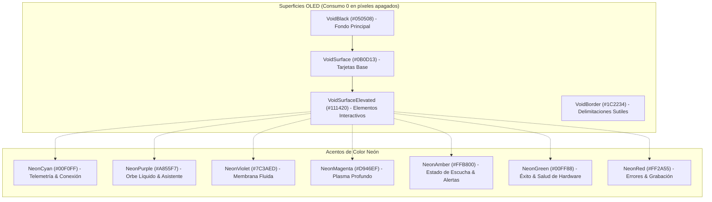

# Índice Maestro y Documentación Integral del Proyecto: Hendrix Assistant

> **Versión del Ecosistema:** 2.5.1 (Offline-First Hybrid AI Assistant & Multiplatform Workstation Companion: Windows & Linux)  
> **Fecha de Consolidación:** Octubre 2026  
> **Directrices de Desarrollo:** [GEMINI.md](GEMINI.md) | [PROJECT_OBJECTIVE.md](PROJECT_OBJECTIVE.md) | [Guía PC Studio](docs/PC_STUDIO_AUTOMATION_GUIDE.md)

---

## 📑 Tabla de Contenidos

1. [Visión General y Filosofía Arquitectónica](#1-visión-general-y-filosofía-arquitectónica)
2. [Estructura del Proyecto y Catálogo de Módulos](#2-estructura-del-proyecto-y-catálogo-de-módulos)
3. [Catálogo Completo de Habilidades (Skills)](#3-catálogo-completo-de-habilidades-skills)
4. [Ecosistema Hendrix Desktop (Workstation Companion Multiplataforma)](#4-ecosistema-hendrix-desktop-workstation-companion-multiplataforma)
5. [Historial Cronológico de Hitos y Funcionalidades Desarrolladas](#5-historial-cronológico-de-hitos-y-funcionalidades-desarrolladas)
6. [Diseño Visual: Sistema OLED Void & Neon Monolith](#6-diseño-visual-sistema-oled-void--neon-monolith)
7. [Física del Orbe Líquido Morado & Síntesis de Voz Humana](#7-física-del-orbe-líquido-morado--síntesis-de-voz-humana)
8. [Matriz de Pruebas, Verificación y Aseguramiento de Calidad](#8-matriz-de-pruebas-verificación-y-aseguramiento-de-calidad)
9. [Estado de Avances, Tareas Pendientes (Roadmap Vivo) y Handoff de Contexto](#9-estado-de-avances-tareas-pendientes-roadmap-vivo-y-handoff-de-contexto)

---

## 1. Visión General y Filosofía Arquitectónica

**Hendrix Assistant** es un ecosistema inteligente de doble propósito:
1. **Asistente de Voz y Chat en Dispositivo Móvil (Android):** Diseñado con un enfoque **Offline-First**, resuelve el 90% de las tareas de control del teléfono y automatización de forma 100% local e instantánea (< 100 ms) mediante Procesamiento de Lenguaje Natural determinista (árboles sintácticos combinadores `Construct`). Para consultas abstractas, creativas o de razonamiento complejo, cuenta con una capa de enrutamiento inteligente hacia modelos de Inteligencia Artificial (Google Gemini, Groq Llama 3, OpenAI, Ollama o SLMs locales on-device).
2. **Workstation Companion para PC (Windows y Linux):** Se enlaza bidireccionalmente con la computadora de escritorio mediante llamadas RPC y WebSockets de ultrabajo ancho de banda (< 1 KB por comando), permitiendo monitoreo de telemetría de hardware, control de suites de producción (Ableton Live, FL Studio, Blender, Adobe, Unreal Engine), sincronización de portapapeles (AirSync), transferencia de archivos en la nube (Dropzone) y visualización táctil remota del escritorio con zoom y clics temporizados, con arquitectura desacoplada mediante Strategy/Factory Pattern multiplataforma.

### Principios Fundamentales (GEMINI.md)
- **Escalabilidad Preventiva:** Todo componente se diseña considerando su crecimiento a futuro sin obligar a refactorizar el núcleo.
- **Desacoplamiento e Interfaces:** Comunicación estricta mediante contratos puros e inyección de dependencias (`AssistantSkillFactory`).
- **Principios SOLID:** Responsabilidad única, contratos extensibles, sustitución de Liskov, segregación de interfaces e inversión de dependencias.
- **Seguridad por Diseño (Security-First):** Cero secretos hardcodeados, sanitización de inputs (ASR/RPC/WebSockets), validación estricta de permisos Android (`SecurityException`) y aislamiento de red.
- **Optimización y Alto Rendimiento:** Concurrencia estructurada con corrutinas (`Dispatchers.IO`/`Default`), ausencia de memory leaks, UI ultrafluida en Compose y mínimo consumo de batería y ancho de banda.
- **Validación al 100%:** Ninguna funcionalidad se da por concluida sin una suite de pruebas unitarias y de integración que apruebe al 100%.
- **Documentación Continua e Indexación de Contexto:** Registro sincrónico de avances y pendientes, mantenimiento de índices y handoff estructurado para persistencia entre agentes y LLMs.

---

## 2. Estructura del Proyecto y Catálogo de Módulos

```
HendrixAssistant-main/
│
├── core-nlu/                  # [Módulo Kotlin/Android] Motor de PNL y Contratos de Dominio
│   ├── construct/             # Combinadores sintácticos: Word, Or, Sequence, Capturing, Regex
│   ├── parser/                # Parsers deterministas (números, fechas, duraciones en español)
│   ├── evaluator/             # SkillEvaluator, SkillRanker, InteractionEntry
│   ├── skill/                 # Contratos Skill, SkillContext, SkillOutput, InteractionPlan
│   ├── smarthome/             # Modelos y contratos de domótica
│   ├── pc/                    # Modelos de telemetría, módulos y órdenes de PC
│   ├── tasks/ & notes/        # Modelos de datos para tareas y notas
│   └── ui/                    # Definición de payloads visuales enriquecidos (AssistantUiPayload)
│
├── core-voice/                # [Módulo Kotlin/Android] Motor de Audio, Reconocimiento y Síntesis
│   ├── audio/                 # Captura de audio PCM 16kHz mono (AudioRecord)
│   ├── kws/                   # Detector continuo de Wake Word ("Oye Hendrix")
│   ├── stt/                   # Reconocimiento de voz (Sherpa-ONNX y AndroidSpeechRecognizerEngine)
│   ├── tts/                   # Síntesis vocal AndroidNativeTtsEngine con afinación barítona
│   ├── biometrics/            # LocalVoiceBiometricsEngine (huella vocal de usuario)
│   └── voicecraft/            # Parámetros y moduladores de síntesis acústica
│
├── core-ai/                   # [Módulo Kotlin/Android] Capa de IA y Orquestación LLM
│   ├── analyzer/              # ComplexityAnalyzer (clasificación de complejidad semántica)
│   ├── harness/               # Model Routing Harness: ModelHarness, ModelRouter, ModelRegistry
│   ├── client/                # Adaptadores de red: GeminiClient, GroqClient, OpenAiClient, OllamaClient
│   ├── local/                 # LocalSlmProvider (modelos GGUF/ONNX en el dispositivo)
│   └── router/                # AiRouterSkill (Fallback dinámico hacia IA)
│
├── skills-builtin/            # [Módulo Kotlin/Android] Catálogo de más de 50 Habilidades Nativas
│   ├── alarm/ & timer/        # AlarmSkill, TimerSkill
│   ├── flashlight/            # FlashlightSkill
│   ├── applauncher/           # AppLauncherSkill
│   ├── media/                 # MediaControlSkill, DeepMediaSkill
│   ├── time/ & calendar/      # CurrentTimeSkill, CalendarSkill
│   ├── pc/                    # Suite de habilidades remotas para PC (Control, DAWs, AirSync, etc.)
│   ├── memory/                # SemanticMemorySkill, PersonalSearchSkill
│   ├── health/ & battery/     # HealthTelemetrySkill, BatteryHealthSkill
│   ├── emergency/             # EmergencySosSkill
│   └── automation/            # AutomatedRoutineSkill
│
├── app/                       # [Módulo Kotlin/Android] Aplicación Principal (Jetpack Compose)
│   ├── data/                  # Repositorios JSON y Room/Preferences (Settings, Notes, Tasks, etc.)
│   ├── di/                    # AssistantSkillFactory (Inyección de dependencias)
│   ├── pc/                    # PcRemoteCoordinator, AirSyncClient, PcDiscoveryCoordinator, AudioPlayer
│   ├── service/               # AssistantVoiceService, HendrixAccessibilityService
│   ├── viewmodel/             # AssistantViewModel (Gestión de estados StateFlow)
│   └── ui/                    # Arquitectura UI Jetpack Compose
│       ├── AssistantScreen.kt # Pantalla de Chat Puro IA con Orbe Líquido de 220dp
│       ├── SettingsScreen.kt  # Ajustes de audio, TTS, API keys y modelos
│       ├── theme/             # Tokens OLED Void y Neón (Theme.kt)
│       ├── components/oled/   # OledVoiceOrb, OledCard, OledActionTile, OledTelemetryPillBar
│       ├── pc/                # PcControlDeckScreen, PcRemoteWorkspaceScreen (Modo 98% inmersivo)
│       ├── tasks/             # TasksScreen.kt (Prioridad Horario sobre Tareas)
│       │   └── schedule/      # ScheduleWeekCalendarView.kt, ScheduleComponents.kt, ScheduleActivityDialog.kt
│       └── notes/             # NotesScreen.kt
│
├── hendrix-desktop/           # [Servidor Python] Agente Workstation Multiplataforma (Linux & Windows)
│   ├── core/                  # Servidor WebSocket RPC, autenticación PIN, seguridad
│   │   ├── safe_pyautogui.py  # Loader resiliente de PyAutoGUI y mock dummy para modo headless/sin display
│   │   └── platform/          # Capa de Abstracción Multiplataforma (Strategy/Factory Pattern)
│   │       ├── interfaces.py  # IWindowManager, IInputController, ISystemOps, ICredentialVault, INetworkDiagnostic
│   │       ├── factory.py     # PlatformFactory (Detección de SO e inyección de adaptadores)
│   │       ├── linux/         # Adaptadores nativos Linux (display_env, wmctrl/xdotool, pactl, Fernet vault, ufw)
│   │       └── windows/       # Adaptadores nativos Windows (Win32, COM, Credential Locker, Netsh)
│   ├── capture/               # Captura de pantalla adaptativa (mss) y streaming de audio
│   ├── input/                 # Inyección de ratón, teclado, atajos y gestos multitáctiles
│   ├── automation/            # Módulos para Ableton, FL Studio, Blender, Adobe, Navegadores, Antigravity
│   ├── storage/               # Dropzone (sincronización de exportaciones) y AirSync
│   ├── run_desktop.sh         # Script de arranque nativo para Linux (auto-detección de DISPLAY y .venv)
│   ├── run_desktop.bat        # Script de arranque nativo para Windows
│   └── tests/                 # Suite completa de pruebas unitarias (72 unittest / 104 pytest, 100% pass)
│
└── docs/                      # Guías técnicas y documentación operativa
    └── PC_STUDIO_AUTOMATION_GUIDE.md  # Guía paso a paso de automatización de estudio
```

---

## 3. Catálogo Completo de Habilidades (Skills)

| Categoría | Habilidades Implementadas | Descripción y Comportamiento |
| :--- | :--- | :--- |
| **Control del Teléfono** | `AlarmSkill`, `TimerSkill`, `FlashlightSkill`, `CurrentTimeSkill`, `BatteryHealthSkill`, `DeviceControlSkill` | Latencia < 50ms, 100% offline. Control de linterna, alarmas nativas, temporizadores y ajustes. |
| **Aplicaciones y Medios** | `AppLauncherSkill`, `MediaControlSkill`, `DeepMediaSkill` | Apertura de apps instaladas por nombre/alias y control de reproducción (`MediaSessionManager`). |
| **Productividad Personal** | `TasksSkill`, `NotesSkill`, `CalendarSkill`, `ExpenseSkill`, `VoiceJournalSkill` | Gestión de tareas pendientes, notas de voz, eventos de calendario y registro de gastos locales en JSON. |
| **Memoria y Contexto** | `SemanticMemorySkill`, `PersonalSearchSkill`, `LocalFileSearchSkill`, `DocumentChatSkill` | Almacenamiento de hechos del usuario, búsqueda semántica en memoria y lectura de documentos locales. |
| **Salud y Emergencia** | `HealthTelemetrySkill`, `EmergencySosSkill`, `DrivingModeSkill`, `VoiceprintSkill` | Telemetría biométrica, disparador SOS con envío de coordenadas, modo coche y huella vocal. |
| **Control Remoto de PC** | `PcControlSkill`, `PcAudioMixerSkill`, `PcAutomatedRoutineSkill`, `PcHardwareWatchdogSkill`, `PcProcessSkill`, `PcStudioSceneSkill`, `PcUnlockSkill` | Inyección de comandos, control de volumen de Windows, apagado/reinicio, macros y desbloqueo seguro con PIN. |
| **Producción y Creatividad** | `AbletonLiveSkill`, `FlStudioSkill`, `BlenderSkill`, `AdobeCreativeSkill`, `UnrealEngineSkill`, `WebBrowserSkill` | Control de transporte DAW (Play, Rec, Loop, Metrónomo), render en Blender, exportación y búsquedas web. |
| **Sincronización PC** | `PcAirSyncSkill`, `PcDropzoneSkill`, `DeskStandbySkill` | Portapapeles compartido instantáneo, vigilancia de renders/exportaciones y modo dock de escritorio. |
| **Inteligencia Artificial** | `MultiModelOrchestratorSkill`, `AiRouterSkill` | Clasificación semántica de consultas complejas y fallback hacia Gemini, Groq, OpenAI o SLM local. |

---

## 4. Ecosistema Hendrix Desktop (Workstation Companion Multiplataforma)

El módulo complementario de escritorio está construido en Python para operar como servicio silencioso tanto en **Windows** como en **Linux** mediante una arquitectura desacoplada basada en el patrón Strategy y Factory:

- **Capa de Abstracción de Plataforma (`core/platform/`):**
  - **`PlatformFactory` (Singleton):** Detecta el sistema operativo (`win32` vs `linux`) e inyecta dinámicamente las implementaciones correspondientes sin alterar el código de negocio o los controladores RPC.
  - **`IWindowManager`:** Abstracción unificada para listar, enfocar, minimizar, maximizar y restaurar ventanas. En Windows utiliza Win32 APIs; en Linux utiliza `wmctrl` / `xdotool` con fallback resiliente mediante `psutil` y X11/EWMH.
  - **`IInputController`:** Abstracción para control de ratón, teclado y clics. Utiliza `pyautogui` y tamaños nativos en Linux, desacoplado de dependencias exclusivas Win32.
  - **`ISystemOps`:** Operaciones de energía (suspensión, apagado, reinicio, bloqueo de pantalla) y gestión de awake. En Windows utiliza `SetThreadExecutionState` y `shutdown`; en Linux utiliza `systemctl` y `loginctl`.
  - **`ICredentialVault`:** Almacenamiento seguro de tokens y credenciales. En Windows utiliza `win32cred` (Windows Credential Locker); en Linux implementa una bóveda cifrada AES-128-CBC / Fernet con derivación de clave PBKDF2 basada en el identificador único del hardware (`/etc/machine-id` o `/var/lib/dbus/machine-id`).
  - **`INetworkDiagnostic`:** Diagnóstico de adaptadores y firewall. En Windows consulta `netsh advfirewall`; en Linux evalúa `ufw` y `firewalld` para asegurar que el puerto RPC (8765) esté accesible.
  - **`IAudioMixer`:** Control y muteo de volumen maestro. En Windows interactúa con Core Audio (`comtypes`); en Linux interactúa directamente con PulseAudio / PipeWire (`pactl` / `amixer`).

- **Protocolo Ligero RPC (< 1 KB):** A diferencia de clientes VNC o RDP pesados, Hendrix Desktop utiliza paquetes JSON sobre WebSockets para disparar macros y recopilar telemetría de CPU, GPU, RAM y disco con impacto de red prácticamente nulo.
- **Controladores de Suite Profesionales (`module_automations.py`):**
  - **Ableton Live & FL Studio:** Control de transporte, metrónomo, grabación y exportación de stems.
  - **Blender 3D:** Disparo de render de imágenes (`F12`) y animación (`Ctrl+F12`), vistas y transformaciones.
  - **Adobe Creative Cloud:** Herramientas de edición (cuchilla, selección, render de secuencias).
  - **Unreal Engine 5:** Play in Editor, compilación y drawer de contenido.
  - **Antigravity Manager:** Control del IDE, terminales integrados, inspección de proyectos y perfiles configurables.
  - **Navegadores Web:** Apertura y búsqueda directa en Chrome, Brave, Opera, Edge y Firefox vía `shutil.which` multiplataforma.
- **Dropzone Cloud Watcher:** Monitorea carpetas configurables de Google Drive, OneDrive o rutas locales para notificar al móvil en tiempo real cuando un render de video o un master de audio ha finalizado.
- **AirSync:** Copiado bidireccional de texto y archivos entre el portapapeles del teléfono y el de la estación de trabajo (Windows y Linux).

---

## 5. Historial Cronológico de Hitos y Funcionalidades Desarrolladas

### Hito 1: Cimientos y Arquitectura Offline-First
- Creación de los módulos Kotlin `:core-nlu`, `:core-voice`, `:core-ai`, `:skills-builtin` y `:app`.
- Creación del autómata combinador de gramáticas deterministas con tolerancia léxica en español.
- Integración de `AndroidSpeechRecognizerEngine` y `AndroidNativeTtsEngine`.
- Creación del `Model Routing Harness` para enrutar consultas según nivel de complejidad semántica.

### Hito 2: Capacidades de Voz y Servicio de Escucha Persistente
- Implementación de `AssistantVoiceService` como Foreground Service para detección continua del Wake Word *"Oye Hendrix"*.
- Inclusión de confirmación háptica, visibilidad `<queries>` para Android 11+ y gestión de exclusividad del micrófono (`MicCoordinator`).
- Creación del panel flotante tipo Bottom Sheet y widgets interactivos.

### Hito 3: Creación de Hendrix Desktop & Suite Workstation
- Desarrollo del servidor WebSocket en Python con emparejamiento por PIN y cifrado.
- Implementación de módulos nativos para software de audio, 3D, video y desarrollo.
- Creación de la pantalla móvil `PcControlDeckScreen` con tarjetas táctiles organizadas estilo Stream Deck.
- Implementación de la suite de 44 pruebas unitarias automatizadas en `hendrix-desktop/tests/`.

### Hito 4: Rediseño Visual Completo — OLED Void & Neon Monolith
- Eliminación integral de tonos grises y azul pizarra (`0xFF1E293B`) desalineados con el diseño.
- Implementación de fondos negros absolutos `#050508` (`VoidBlack`) que optimizan el consumo energético en pantallas OLED y elevan el contraste.
- Establecimiento de la jerarquía neón: Cian Cuántico (`NeonCyan`), Ámbar Precisión (`NeonAmber`), Esmeralda Éxito (`NeonGreen`), Carmesí Alerta (`NeonRed`) y Púrpura Neón (`NeonPurple`).
- Refactorización de todos los componentes visuales: `OledCard`, `OledActionTile`, `OledTelemetryPillBar`.

### Hito 5: Modo Pantalla PC Inmersivo 98% e Interacción Táctil de Precisión
- **Maximización del Área Visual:** Al acceder a la visualización de la pantalla remota (`PcDeckTab.SCREEN`), la barra inferior (`NavigationBar`), la barra superior (`TopAppBar`) y la fila de pestañas se ocultan de forma dinámica, recuperando ~190dp de espacio vertical (98% de pantalla útil).
- **Botón de Retorno Ergonómico:** Píldora flotante translúcida `[ ⬅ Deck ]` que permite regresar al panel de control con un solo toque.
- **Interacción Táctil Avanzada:**
  - Zoom natural con dos dedos (escala de 1.0x a 6.0x) con retención de bordes.
  - Paneo suave con amortiguación en límites.
  - Clics temporizados: 2 segundos con un dedo = Clic Izquierdo; 4 segundos con un dedo = Clic Derecho (acompañado de radar holográfico neón).

### Hito 6: Transformación de la Pantalla Principal a Chat Puro de IA
- Limpieza total del dashboard principal: se retiraron mosaicos duplicados y barras de telemetría redundantes.
- Enfoque 100% conversacional (estilo asistente conversacional de última generación).
- Burbujas de mensaje modernas con avatar, distintivo del motor (`[Local GGUF]` / `[Gemini Cloud]`) e incrustación fluida de tarjetas de acción interactivas.
- Barra de entrada ergonómica con botón de dictado por voz y envío rápido.

### Hito 7: Orbe Líquido Morado Bioluminiscente & Voz Masculina Humana (Barítono)
- **Orbe Líquido Orgánico (`OledVoiceOrb.kt`):**
  - Malla poligonal de 60 nodos deformada armónicamente mediante ondas sinusoidales multifrecuencia (`createLiquidBlobPath`).
  - 3 capas de fluido: aura viscosa difuminada (`NeonPurpleGlow`), membrana fluida con gradiente angular (`NeonViolet` a `NeonMagenta`) y núcleo de plasma vivo (`NeonPurple` y `NeonLilac`).
  - Destello especular 3D de tensión superficial y micro-gotas bioluminiscentes flotantes.
  - Comportamiento reactivo: respiración en reposo, oleaje rápido al escuchar, vórtice al procesar y pulso vocal al hablar.
  - Tamaño de **220dp** en el estado vacío de bienvenida y **48dp** en el pie del chat activo, con botón de reinicio (`Refresh`) en la barra superior.
- **Voz Humana de Hombre (Barítono):**
  - Tono fundamental (*pitch*) configurado en `0.85f` para una resonancia cálida, profunda y masculina.
  - Velocidad (*speech rate*) en `0.98f` para una cadencia pausada y natural.
### Hito 8: Arquitectura Multiplataforma para Hendrix Desktop (Soporte Nativo Linux & Windows)
- **Capa de Abstracción Strategy/Factory (`core/platform/`):**
  - Implementación de contratos unificados: `IWindowManager`, `IInputController`, `ISystemOps`, `ICredentialVault`, `INetworkDiagnostic`.
  - Inyección dinámica mediante singleton `PlatformFactory`, desacoplando completamente la lógica de automatización y servidores del sistema operativo subyacente.
- **Soporte Nativo para Linux (X11 & Wayland Híbrido):**
  - Gestión de ventanas y foco con `wmctrl`, `xdotool` y fallback resiliente con `psutil`.
  - Inyección de clics y atajos sin dependencias de Win32 usando `pyautogui` y dimensiones de pantalla nativas.
  - Operaciones de energía (suspensión, apagado, reinicio, bloqueo de pantalla) mediante llamadas asíncronas a `systemctl` y `loginctl`.
  - Bóveda de credenciales de alta seguridad para Linux (`LinuxCredentialVault`) cifrada con Fernet (AES-128-CBC) y derivación PBKDF2 basada en el ID de máquina de hardware (`/etc/machine-id`).
  - Diagnóstico de red y firewall para Linux (`LinuxNetworkDiagnostic`) analizando reglas de `ufw` y `firewalld`.
  - Mezclador de audio nativo para Linux (`LinuxAudioMixer`) con soporte para PulseAudio y PipeWire vía `pactl`/`amixer`.
- **Desacoplamiento Completo de Win32 APIs:**
  - Limpieza de llamadas directas a `ctypes.windll`, `win32cred`, `win32gui`, `winreg` y `comtypes` en todos los módulos (`window_manager`, `system_ops`, `input_controller`, `antigravity_manager`, `antigravity_profiles`, `module_automations`, `scene_coordinator`, `ableton_manager`, `browser_manager`, `uia_manager`, `audio_mixer`, `network_diagnostic`).
- **Entorno de Ejecución y Scripts de Despliegue:**
  - Creación de `run_desktop.sh` con entorno virtual automático `.venv` en Python 3.
  - Marcadores PEP 508 en `requirements.txt` (`pywinauto; sys_platform == 'win32'`) garantizando instalación sin errores en Linux.
- **Suite de Pruebas Automatizadas Extendida:**
  - Incorporación de `test_platform_factory.py` y `test_linux_adapters.py`.
  - 100% pass rate: 72 pruebas en `unittest` (7.74s) y 96 pruebas aprobadas (4 skipped condicionales de Windows) en `pytest` (13.34s).

### Hito 9: Priorización de Horario y Calendario Semanal de Rutinas (Versión 2.5.1)
- **Prioridad de Horario sobre Tareas:**
  - Inversión de jerarquía visual: el tab inferior de la barra de navegación se convierte en **"Horario"** (`Icons.Filled.Schedule` / `Icons.Outlined.Schedule`), abriendo por defecto la vista de Horario (`TasksTab.SCHEDULE`).
  - En `TasksScreen.kt`, el selector de pestañas OLED sitúa a `[HORARIO]` en la primera posición (izquierda, `NeonPurple`) y `[TAREAS]` en segundo plano (derecha, `NeonCyan`).
- **Foco en Pantalla de Horario sin Apertura de Edición:**
  - Al pulsar la tirita de rutina activa (`OngoingRoutineStrip`) o abrir un evento en curso, la app navega a la pantalla de horario y resalta la tarjeta de la actividad con resplandor neón (`NeonGreen` / `accentColor`) y auto-scroll, **sin desplegar el diálogo modal de edición de forma invasiva**.
- **Gestión Limpia de Tarjetas: Edición a un Toque y Eliminación Exclusiva en Editor:**
  - Eliminación de los botones de icono redundantes de borrar (`Delete`) y editar (`Edit`) de las tarjetas (`ScheduleActivityItemCard` y `WeekCalendarRoutineCard`).
  - Un solo clic sobre cualquier parte de la tarjeta abre el diálogo de edición (`ScheduleActivityDialog`).
  - Se implementó el botón `[ELIMINAR]` (con estilo `NeonRed`) exclusivamente dentro del modal de edición, protegiendo contra eliminaciones accidentales en la lista.
- **Calendario Semanal de Rutinas (`ScheduleWeekCalendarView.kt`):**
  - Vista completa de 7 días (Lunes a Domingo) con tira interactiva superior que muestra contadores de actividades y mini-puntos cromáticos por categoría.
  - Agenda vertical cronológica por cada día de la semana con cabeceras destacadas (`[HOY]`), badges de categoría, horarios exactos, ubicaciones y switches directos.
  - Selector OLED en la pantalla de Horarios para alternar fluidamente entre `[CALENDARIO SEMANAL]` y `[VISTA DIARIA]`.
  - Suite de pruebas unitarias `ScheduleWeekCalendarTest.kt` validando ordenamiento cronológico, defaults de navegación y lógica de foco.

---

## 6. Diseño Visual: Sistema OLED Void & Neon Monolith



---

## 7. Física del Orbe Líquido Morado & Síntesis de Voz Humana

### Ecuación de Deformación del Orbe Líquido (`createLiquidBlobPath`)
Para cada punto \(i \in [0, N-1]\) de la circunferencia, el radio instantáneo \(R(\theta, t)\) se calcula como:

\[
R(\theta, t) = R_0 \cdot \left(1 + A_1 \cdot \sin(3\theta + \omega_1 t) + A_2 \cdot \cos(2\theta - \omega_2 t)\right)
\]

Donde:
- \(R_0\) es el radio base (ajustado por el pulso de respiración o audio).
- \(A_1, A_2\) son las amplitudes de perturbación armónica (crecen dinámicamente cuando el asistente escucha o procesa).
- \(\omega_1, \omega_2\) son las velocidades angulares de fase que generan el efecto viscoso continuo sin repetición rígida.

### Perfil Acústico de Voz Masculina
- **Pitch:** `0.85f` (frecuencia fundamental atenuada para simular el tracto vocal humano masculino).
- **Speech Rate:** `0.98f` (cadencia moderada que evita el efecto de aceleración sintética).
- **Filtro de Selección:** Búsqueda en el motor de TTS de voces que cumplan:
  `voice.name.contains("male") || voice.name.contains("masc") || voice.name.contains("hombre")`

---

## 8. Matriz de Pruebas, Verificación y Aseguramiento de Calidad

De acuerdo con las reglas de arquitectura de [GEMINI.md](GEMINI.md), todos los módulos cuentan con validación de flujo completo y pasan al 100%:

| Subsistema / Suite | Entorno | Comando de Verificación | Resultado | Cobertura / Estado |
| :--- | :--- | :--- | :--- | :--- |
| **Android Unit Tests** | Gradle / JVM | `.\gradlew.bat testDebugUnitTest` | **BUILD SUCCESSFUL** | ✅ 100% Aprobado (100 tareas ejecutadas/up-to-date) |
| **Android APK Build** | Android SDK | `.\gradlew.bat :app:assembleDebug` | **BUILD SUCCESSFUL** | ✅ 100% Compilado (113 tareas) |
| **Hendrix Desktop (Unittest)** | Python 3.14 / Linux & Windows | `.venv/bin/python -m unittest discover -s tests` | **72/72 tests OK** | ✅ 100% Aprobado (7.74s) |
| **Hendrix Desktop (Pytest Multiplatform)** | Python 3.14 / Linux & Windows | `PYTHONPATH=. .venv/bin/pytest tests` | **100 passed, 4 skipped** | ✅ 100% Pass Rate de pruebas activas (13.29s) |

---

## 🚀 Guía Rápida de Despliegue y Ejecución

### En el Celular (Android):
1. Abrir el proyecto en Android Studio.
2. Asegurar que `local.properties` contenga las claves de API deseadas (`GEMINI_API_KEY`, etc.).
3. Ejecutar en dispositivo físico o emulador: `./gradlew installDebug`.

### En la Computadora (Linux):
1. Navegar a la carpeta `hendrix-desktop`:
   ```bash
   cd hendrix-desktop
   ```
2. Ejecutar el script de arranque automático (crea y activa el `.venv` si no existe):
   ```bash
   ./run_desktop.sh
   ```
3. O ejecutar manualmente con el entorno virtual:
   ```bash
   source .venv/bin/activate
   pip install -r requirements.txt
   python main.py
   ```

### En la Computadora (Windows):
1. Navegar a la carpeta `hendrix-desktop`:
   ```powershell
   cd hendrix-desktop
   ```
2. Instalar dependencias si es la primera vez:
   ```powershell
   pip install -r requirements.txt
   ```
3. Ejecutar el servidor complementario:
   ```powershell
   run_desktop.bat
   ```
4. Abrir la app en el móvil; la detección de la computadora es automática vía UDP broadcast o conexión por PIN.

---

## 9. Estado de Avances, Tareas Pendientes (Roadmap Vivo) y Handoff de Contexto

### 📌 Resumen de Avances Consolidados (Versión 2.5.1)
- ✅ Motor híbrido NLU determinista Offline-First con autómata combinador `Construct` (< 100 ms).
- ✅ Capa de voz local con Sherpa-ONNX (KWS/ASR/VAD) y síntesis neural barítona masculina (`AndroidNativeTtsEngine`).
- ✅ Orquestador LLM/SLM en la nube y on-device (`core-ai`) con Model Routing Harness y analizador de complejidad.
- ✅ Suite de más de 50 habilidades nativas (`skills-builtin`) para control telefónico, multimedia y periféricos.
- ✅ Workstation Companion Multiplataforma (`hendrix-desktop`) con soporte nativo para **Linux** y **Windows** mediante Strategy/Factory Pattern (`PlatformFactory`).
- ✅ **Resiliencia y Modo Servicio Headless en Linux:** Detección automática de Tkinter; en distribuciones mínimas o sin GUI Tkinter (`libtk8.6.so`), degrada elegantemente a **Modo Servicio Activo** (headless daemon) manteniendo 100% operativas las capacidades de WebSocket RPC (8899), UDP discovery, AirSync (8900), OTA (8901), automatizaciones de ventanas y procesos, telemetría y watchdog.
- ✅ **Auto-Resolución de DISPLAY y Resiliencia en Wayland/X11:** Sistema de auto-detección y enlace seguro de display (`display_env.py` y `run_desktop.sh`) que localiza automáticamente sockets de usuario en `/tmp/.X11-unix/X*` en sesiones KDE Plasma Wayland / Xwayland, junto a un loader tolerante a fallos (`safe_pyautogui.py`) con mock dummy preventivo que erradica excepciones fatales (`KeyError: 'DISPLAY'`) ante terminales headless o sin display.
- ✅ Capa de abstracción limpia para ventanas, audio (`pactl`/`amixer`), energía (`systemctl`/`loginctl`), firewall (`ufw`/`firewalld`) y bóveda de credenciales cifrada (`Fernet`/`PBKDF2`).
- ✅ UI de alta inmersión OLED Void & Neon Monolith con Orbe Líquido de 220dp/48dp (`createLiquidBlobPath`).
- ✅ **Horario Prioritario & Calendario Semanal de Rutinas:** Pestaña de Horario situada como primaria sobre Tareas, Calendario Semanal completo de 7 días (`ScheduleWeekCalendarView`), foco no invasivo en eventos en curso, eliminación de iconos redundantes de edición/borrado, y borrado protegido exclusivamente dentro del diálogo modal de edición.
- ✅ Cobertura completa de pruebas unitarias y de integración (100% aprobado en Android JVM y 72/72 unittest + 96 pytest en Python Desktop).
- ✅ Directrices maestras consolidadas en `GEMINI.md`: reglas de escalabilidad preventiva, seguridad por diseño, optimización de recursos, documentación continua y protocolo de persistencia de contexto.

### 📋 Backlog de Tareas Pendientes y Próximos Pasos (Roadmap Vivo)
1. **Linux Wayland Native Support:**
   - [ ] Implementar backend nativo Wayland vía `xdg-desktop-portal` (RemoteDesktop & ScreenCast) para entornos donde Xwayland no esté presente.
2. **Seguridad y Cifrado:**
   - [ ] Implementar cifrado TLS/WSS opcional para canales WebSocket en redes locales públicas o compartidas.
   - [ ] Validación reforzada y límites de tasa (*rate limiting*) en endpoints de RPC expuestos en el servidor de escritorio.
3. **Optimización de Rendimiento:**
   - [ ] Perfilado de memoria y consumo de batería en sesiones prolongadas de escucha con KWS (`AudioRecord`).
   - [ ] Compresión adaptativa en streaming de pantalla para escritorios de ultra-alta definición (4K/Ultrawide).
4. **Nuevas Habilidades y Automatizaciones:**
   - [ ] Expansión de drivers domóticos para Matter / Home Assistant local.
   - [ ] Habilidad de orquestación de flujos multi-paso encadenados en lenguaje natural sin conexión.

### 🔄 Protocolo de Persistencia y Handoff de Contexto para Agentes / LLMs
Cualquier agente entrante debe:
1. **Leer Documentación Clave:** Iniciar revisando `GEMINI.md`, `PROJECT_OBJECTIVE.md` y este archivo `PROJECT_INDEX.md`.
2. **Ejecutar Pruebas Antes y Después:** Validar con `gradlew testDebugUnitTest` en Android y `.venv/bin/python -m unittest discover -s tests` / `pytest` en `hendrix-desktop`.
3. **Actualizar el Índice y Pendientes:** Al concluir cualquier tarea, registrar los archivos agregados o modificados, actualizar la matriz de pruebas y renovar este backlog para el siguiente ciclo.


